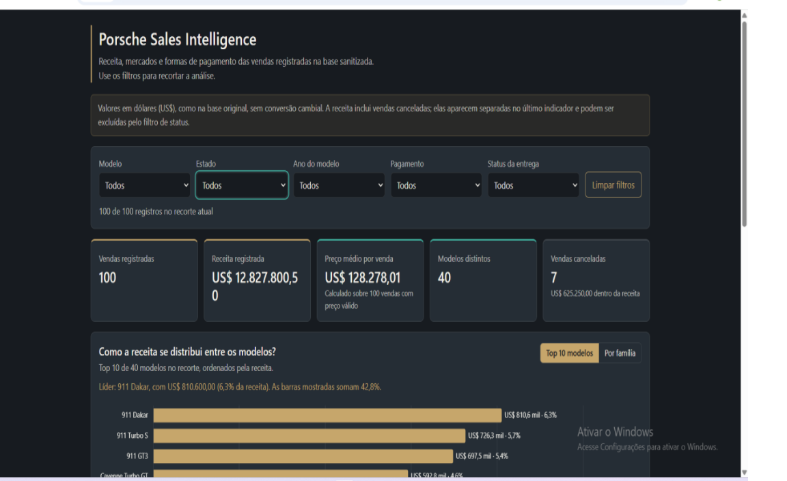
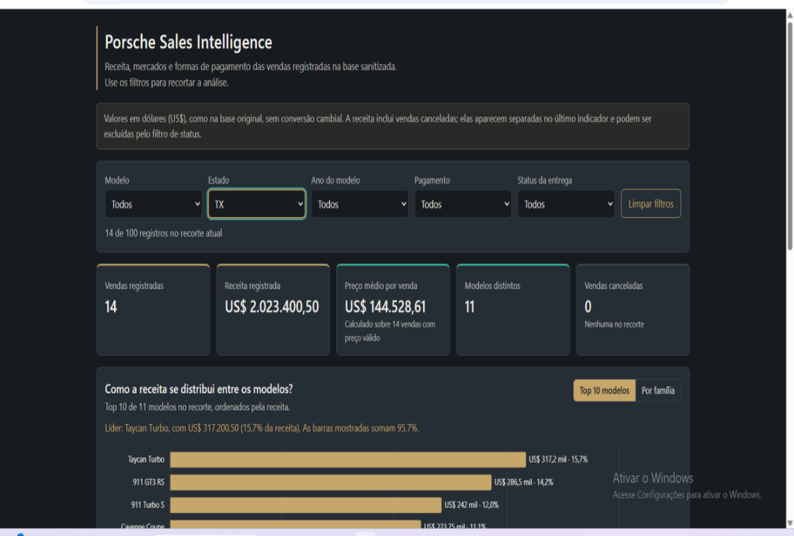

# Porsche Sales Intelligence

Dashboard interativa de vendas Porsche, em um único arquivo HTML (HTML, CSS e JavaScript), feita a partir da planilha sanitizada do desafio da DIO.

**Dashboard publicada:** https://marcxellcamargo-cloud.github.io/porsche-sales-intelligence/

## Evidência de funcionamento
Dashboard completa, sem filtros (100 vendas, US$ 12.827.800,50):

Exemplo de filtro aplicado, Estado = TX (14 vendas):

## Perguntas de negócio e por que as escolhi
1. **Como a receita se distribui entre os modelos?** Mostra onde está o dinheiro. Como são 40 modelos com 1 a 4 vendas cada, o gráfico mostra o Top 10 e permite agrupar por família (911, Taycan, Cayenne, Panamera, Macan, 718).
2. **Quais estados vendem mais e faturam mais?** Compara volume e receita, porque mais vendas não significam mais receita (CA tem mais vendas, TX tem mais receita). A base tem 79 cidades, quase todas com 1 ou 2 vendas; por isso usei estado. Observação: a dashboard de referência da DIO também tem uma visão por estado. Ela só foi consultada depois de a pergunta já estar definida no meu briefing, e a minha análise é independente: top 10, alternância entre receita e vendas e leitura dinâmica do líder de cada métrica.
3. **Como as vendas se dividem por método de pagamento?** Quantidade e percentual de cada método. É uma descrição do registro, não uma conclusão sobre preferência dos clientes.

## Ferramenta usada
Usei **o Claude (Anthropic)** em conversa, em etapas: primeiro o diagnóstico da base, depois a construção do HTML. Não usei ChatGPT com Canvas nem agente com skill.

## O prompt e o que mudou até a versão final
**Prompt inicial:** um briefing longo pedindo uma dashboard autoral em um único `index.html`, com três perguntas de negócio, filtros (modelo, local, ano, pagamento), indicadores de topo, paleta própria (grafite, cinza aço, dourado, turquesa, marfim), tratamento explícito de dados inválidos e documentação das decisões.

**O que mudou depois de analisar a base:**
- Moeda: o briefing previa reais; a base está em dólares, então a dashboard exibe US$, sem conversão cambial.
- Local: cidade virou estado, por legibilidade.
- Ano: o filtro usa o ano do modelo (100% válido), não a data da venda (24 datas inválidas).
- Status de entrega: entrou como quinto filtro, e as vendas canceladas ganharam indicador próprio.
- Botões extras: Top 10 por modelo ou por família, e receita ou quantidade por estado.

## Tratamento da base antes da IA
- Só as colunas sanitizadas foram usadas; nomes de clientes e vendedores não foram incorporados (a base vai dentro do HTML, então não pode ter dado pessoal).
- Preço, ano e quilometragem estavam como texto e foram convertidos para número; os valores entram no código como números, sem fórmulas.
- A coluna crua foi comparada com a sanitizada nos 100 registros; as conversões de preço, ano, pagamento, estado e status estão corretas.
- 24 de 100 datas são `INVALID` (datas impossíveis, como 30/02) e ficaram como ausentes, nunca como zero. 20 das 76 datas válidas são futuras (até 2027). As datas não entram nos gráficos.
- Preços como "68.900 dollars" foram lidos com o ponto como separador de milhar, coerente com a faixa de US$ 58,9 mil a US$ 286,5 mil.
- Nenhum registro foi descartado: são 100 incorporados.

## Decisões de design
Fundo grafite, cartões em cinza aço, dourado para a hierarquia e a receita, turquesa para as comparações. Filtros ativos ficam com borda dourada, há estado vazio e aviso se a biblioteca de gráficos não carregar. Layout responsivo.

## Testes
A lógica (filtros, receita, média e agrupamentos) foi conferida em Node contra os valores calculados em pandas: 100 vendas, US$ 12.827.800,50, média de US$ 128.278,01 e 40 modelos. Testei os filtros no navegador e no GitHub Pages.

## Limitações
Base pequena (100 registros): os rankings descrevem esta amostra e não permitem concluir rentabilidade, preferência ou causalidade. A receita registrada inclui vendas canceladas (US$ 625.250), destacadas no indicador próprio.

## Possível evolução
Escrever uma segunda regra de tratamento para as 24 datas `INVALID` e analisar a evolução das vendas no tempo.
